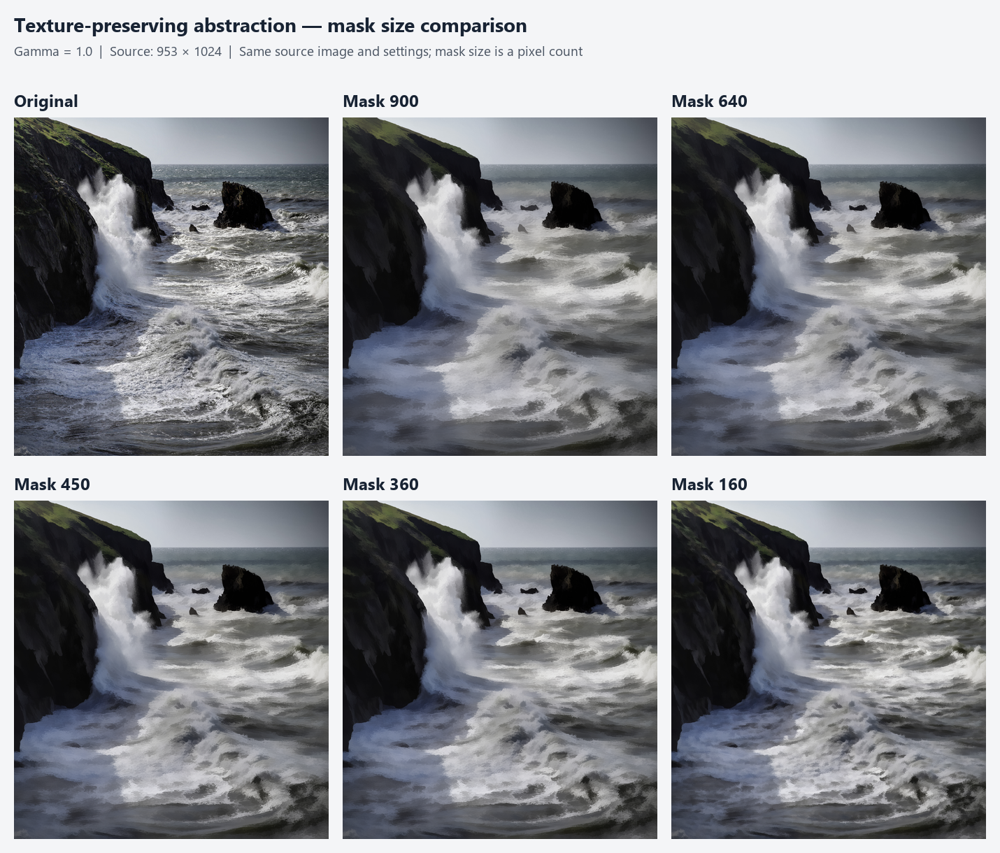
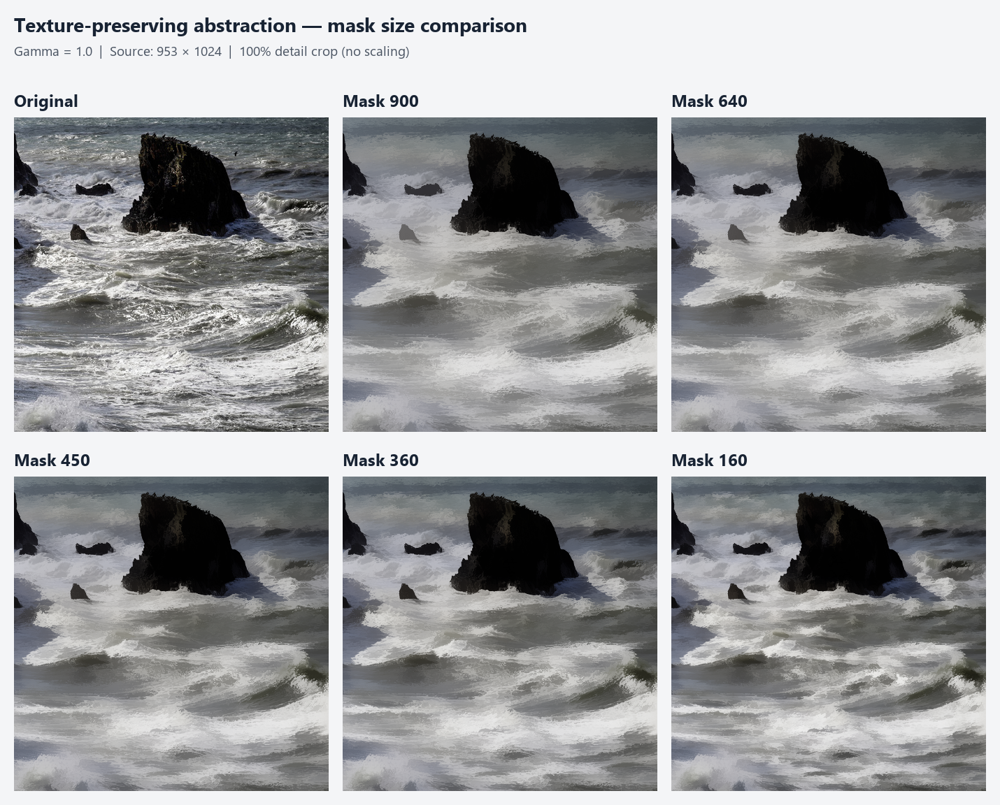

# Mask size comparison

Input: `images/paper-original.jpg`, 953 × 1024, RGB. Gamma is fixed at 1.0.

Mask size is the number of accepted neighborhood pixels, including the center.

All five runs completed successfully. Each output is a valid PNG with the original dimensions and RGB mode. The input is unchanged, and all five outputs differ from one another.





The detail image uses the same 450 × 450 crop at native resolution for every panel (x=450..899, y=170..619).

| Mask size | Filter time (s) | Mean absolute RGB difference from input (0–255) | Output |
| ---: | ---: | ---: | --- |
| 900 | 118.331 | 10.4046 | [PNG](mask-900.png) |
| 640 | 83.710 | 9.8956 | [PNG](mask-640.png) |
| 450 | 58.004 | 9.3966 | [PNG](mask-450.png) |
| 360 | 46.064 | 9.0869 | [PNG](mask-360.png) |
| 160 | 21.069 | 7.9541 | [PNG](mask-160.png) |

Five concurrent single-threaded filter processes; timings include concurrent CPU load.

## Reproduce

From the project root in PowerShell:

```powershell
.\build\texture_abstraction.exe .\images\paper-original.jpg .\results\mask-size-comparison\mask-900.png 900 1.0
.\build\texture_abstraction.exe .\images\paper-original.jpg .\results\mask-size-comparison\mask-640.png 640 1.0
.\build\texture_abstraction.exe .\images\paper-original.jpg .\results\mask-size-comparison\mask-450.png 450 1.0
.\build\texture_abstraction.exe .\images\paper-original.jpg .\results\mask-size-comparison\mask-360.png 360 1.0
.\build\texture_abstraction.exe .\images\paper-original.jpg .\results\mask-size-comparison\mask-160.png 160 1.0
```

Hashes, checks, and timing metadata are in `measurements.json`. The saved results
and timings are from the original MSVC/OpenCV run; the commands above use the
current shared GCC/MinGW build.
